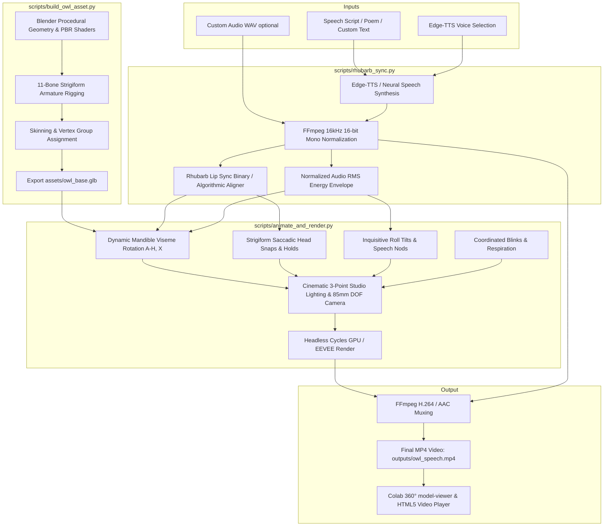

# 🦉 Owl 3D Speech — Procedural 3D Rigged Speech Animation

A complete, self-contained headless Blender and Rhubarb-driven 3D speech animation pipeline that generates, rigs, and animates a stylized 3D owl with authentic strigiform biomechanics, neural TTS speech, and interactive Google Colab execution.

---

## 📋 Overview & Key Features

- **Procedural 3D Rigged Owl Asset (`scripts/build_owl_asset.py`)**:
  - Programmatically generates complete owl anatomy: egg-shaped body torso, soft protruding chest bib, heart-shaped/circular facial disc, large golden amber irises, pupils, gloss corneas, hooked upper beak, articulated lower mandible, ear tufts (*plumicorns*), folded side wings, tail, and perched wooden branch.
  - Generates an 11-bone hierarchical armature rig (`Root`, `Spine`, `Chest`, `Neck`, `Head`, `Beak_Lower`, `Beak_Upper`, `Eyelid_L`, `Eyelid_R`, `EarTuft_L`, `EarTuft_R`).
  - Assigns calibrated PBR Principled BSDF materials and exports a clean, self-contained `owl_base.glb`.

- **Acoustic & Phonetic Synchronization (`scripts/rhubarb_sync.py`)**:
  - Neural text-to-speech synthesis via Microsoft Edge-TTS (`edge-tts`) with dignified British and American presets (`en-GB-RyanNeural`, `en-US-ChristopherNeural`, etc.).
  - Rhubarb Lip Sync binary integration for standard mouth visemes ($A$–$H, X$).
  - High-precision algorithmic Python fallback aligner that analyzes acoustic RMS bursts and syllabic envelopes when Rhubarb is not present.
  - Normalized audio RMS envelope generation at target FPS for dynamic jaw scaling.

- **Strigiform Biomechanical Animation (`scripts/animate_and_render.py`)**:
  - **Saccadic Head Snaps**: Strigiformes (owls) have fixed tubular eyes locked into cranial sockets by sclerotic rings and cannot rotate their eyes. The pipeline simulates natural strigiform gaze shifts via rapid 2–3 frame head rotations (yaw/pitch) followed by rock-steady 1.5–3.5s stabilization holds.
  - **Dynamic Mandible Pitch**: Beak opening angle is scaled dynamically: $\text{Angle}(t) = \text{BaseAngle}(\text{viseme}) \times (0.4 + 0.6 \cdot \text{RMS}_{norm}(t))$.
  - **Inquisitive Roll Tilts**: Characteristic $\pm 15^\circ$ to $\pm 22^\circ$ head rolls at phrase breaks and clause transitions.
  - **Vocal Emphasis Nods**: Downward head dips ($-4^\circ$ to $-6^\circ$) on high-energy speech peaks.
  - **Coordinated Blinking**: 2-frame eyelid closures synchronized with saccade settlements and periodic intervals.
  - **Subtle Breathing**: Gentle sinusoidal chest scaling and spinal sway.

- **Headless GPU Staging & Rendering**:
  - Cinematic 3-point portrait lighting (warm golden key, cool sky fill, sharp rim light).
  - 85mm portrait telephoto camera with depth-of-field bokeh.
  - Full Cycles GPU (OptiX / CUDA / Metal) and EEVEE rendering support.
  - FFmpeg automated muxing with AAC audio to web-optimized H.264 MP4.

- **Google Colab Notebook (`Owl_3D_Speech.ipynb`)**:
  - Fully automated one-click setup downloading portable Blender 4.0 and Rhubarb binaries.
  - Interactive `<model-viewer>` cell for 360° model inspection prior to rendering.
  - Interactive form widgets for text selection, voice presets, and render configurations.
  - In-notebook HTML5 responsive player and direct video download card.

---

## 🏛️ Pipeline Architecture



---

## 📐 Viseme Pitch Mapping & Dynamics

The articulated lower mandible (`Beak_Lower`) rotates downward along its local X-axis according to the standard Rhubarb phonetic alphabet:

| Viseme | Description / Phonemes | Base Angle (deg) | Biomechanical Dynamics |
| :---: | :--- | :---: | :--- |
| **`X`** | Rest / Silence / Idle | $0.0^\circ$ | Closed mandible |
| **`A`** | Plosives / Bilabials ($P, B, M$) | $0.0^\circ$ | Mandible touching upper beak |
| **`B`** | Consonants ($K, S, T, D, N$) | $-7.0^\circ$ | Slight narrow opening |
| **`C`** | Moderate Open Vowels ($EH, AE$) | $-16.0^\circ$ | Mid jaw drop |
| **`D`** | Wide Open Vowels ($AA, AO, AW$) | $-28.0^\circ$ | Maximum vocal cavity opening |
| **`E`** | Mid / Neutral Vowels ($ER, IH, IY$) | $-13.0^\circ$ | Neutral articulation |
| **`F`** | Labiodentals / Fricatives ($F, V$) | $-12.0^\circ$ | Mandible retracted |
| **`G`** | Upper-palatal / Velars ($L, CH, J$) | $-8.0^\circ$ | Narrow jaw posture |
| **`H`** | Wide Breath / Aspiration ($W, OO, OW$) | $-20.0^\circ$ | Open rounded aperture |

### Dynamic RMS Modulation
Every frame's mandible pitch is modulated by the localized acoustic energy:
$$\theta_{\text{mandible}}(t) = \theta_{\text{base}}(\text{viseme}_t) \times \left(0.40 + 0.60 \times \text{RMS}_{\text{normalized}}(t)\right)$$

---

## 🚀 Quickstart & Standalone CLI

### 1. Requirements
- Python 3.9+
- Blender 3.6 LTS, 4.0+, or 4.2+
- FFmpeg (available in PATH)
- Dependencies: `pip install -r requirements.txt`

### 2. Recite a Preset Poem
```bash
python3 run_pipeline.py --poem the_owl --voice ryan --engine CYCLES --samples 32
```

### 3. Recite Custom Text
```bash
python3 run_pipeline.py --text "Wisdom comes from the silence between thoughts." --voice christopher
```

### 4. Animate to Custom Audio
```bash
python3 run_pipeline.py --audio /path/to/my_speech.wav --output outputs/my_owl.mp4
```

### 5. Generate Procedural 3D Asset Only
```bash
python3 run_pipeline.py --generate_asset_only
```

---

## 📓 Google Colab Workflow (`Owl_3D_Speech.ipynb`)

1. Open `Owl_3D_Speech.ipynb` in Google Colab (free T4 GPU recommended).
2. **Step 1 (Toolchain)**: Automatically downloads portable Blender 4.0 Linux x64 and Rhubarb Lip Sync binary without root installation.
3. **Step 2 (3D Model)**: Procedurally generates `owl_base.glb` and renders an interactive `<model-viewer>` orbit widget directly in the notebook cell.
4. **Step 3 (Speech)**: Select poems (Tennyson's *The Owl*, Kipling's *If—*, etc.) or enter custom text; synthesizes speech audio with Edge-TTS.
5. **Step 4 (Render)**: Runs headless Blender with GPU Cycles acceleration and live progress logging.
6. **Step 5 (Playback)**: Displays the final video in a responsive HTML5 card with one-click MP4 download.

---

## 📁 Repository Structure

```
owl-3d-speech/
├── AGENTS.md                  # Project agent guidelines & rules
├── CLAUDE.md                  # Pointer to AGENTS.md
├── README.md                  # Comprehensive documentation & architecture
├── requirements.txt           # Python dependencies (edge-tts, scipy, numpy)
├── Owl_3D_Speech.ipynb        # Complete interactive Google Colab notebook
├── run_pipeline.py            # Master CLI orchestrator
├── scripts/
│   ├── build_owl_asset.py     # Procedural 3D owl mesh, rig & PBR generator
│   ├── rhubarb_sync.py        # Edge-TTS synthesis & Rhubarb/algorithmic aligner
│   └── animate_and_render.py  # Headless Blender strigiform animator & renderer
├── assets/
│   ├── sample_poem.txt        # Presets (Tennyson, Kipling, Nursery Rhymes)
│   ├── sample_speech.wav      # Pre-rendered 16kHz reference audio
│   └── owl_base.glb           # Generated procedural rigged 3D owl model
└── outputs/                   # Rendered videos, audio, visemes and envelopes
```

---

## 📜 License

MIT License. Crafted for high-fidelity 3D procedural speech animation.
